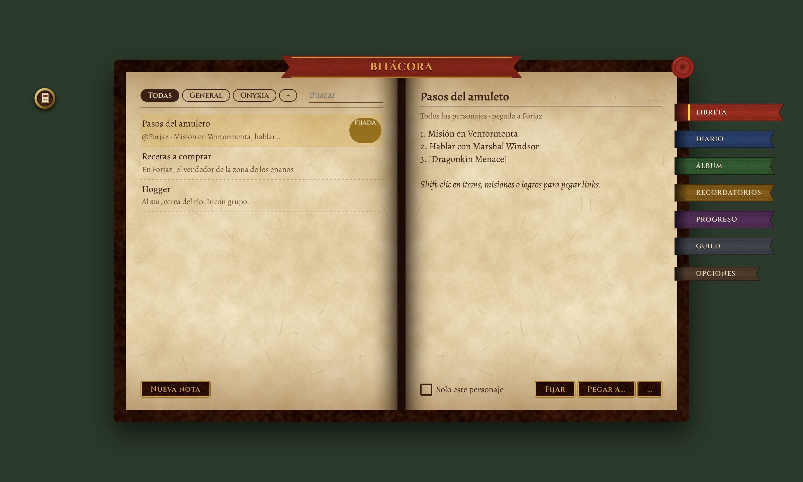

# Pergamino

La piel compartida de los addons de José Argento para WoW Forever: un libro abierto de pergamino dentro de una tapa de cuero, marcadores de tela como pestañas, tinta y tipografía de manuscrito (Cinzel para títulos, Alegreya para el cuerpo). Nada de plantillas de Blizzard: cada pieza se dibuja acá, con texturas y fuentes propias.



## Cómo se usa

Cada addon lleva **su propia copia** de `Libs/Pergamino` (no es una dependencia aparte):

```bash
tools/vendor.sh /ruta/a/MiAddon      # copia Libs/Pergamino adentro del addon
```

y en el `.toc`, como primer archivo:

```
Libs\Pergamino\Pergamino.lua
```

`Bindings.xml` (los atajos de teclado) **no va en el TOC**: el juego lo carga solo por su nombre, y listado lo lee como XML de interfaz y avisa "Unrecognized XML: Binding".

La librería define un global `Pergamino`. Si dos addons traen copias, queda la más nueva (`Pergamino.VERSION`); las texturas y fuentes se leen de la carpeta del addon cuya copia se cargó, así que cada copia tiene que estar completa.

## API

Todo devuelve frames normales de WoW; los puntos y tamaños los ponés vos.

| Función | Qué devuelve |
|---|---|
| `Pergamino.Book(name, opts)` | El libro. `opts = { title, width (860), height (540), single = false, tabs = { { "clave", "Rótulo" }, … }, escape = true }`. Tiene `.left` y `.right` (áreas de contenido de cada página; `.right` es nil en modo `single`), `.title`, `.close` (el sello de lacre), `.tabs[clave]`, `:AddTab(clave, rótulo)`, `:AddPage(clave)` → `{ left, right }` (frames que se muestran solo con esa pestaña), `:SelectTab(clave)`, `:SetTitle(texto)`, `:SetTabsShown(bool)`, `.OnTab = function(clave)`, `.OnMoved = function(point, …)`, `.selected`. Se mueve arrastrando, se cierra con Escape y suena al abrir, cerrar y pasar de página. |
| `Pergamino.Label(parent, texto, rol, justify)` | Un texto. Roles: `title`, `heading`, `subheading`, `body`, `strong`, `italic`, `big`, `small`, `muted`, `link`. |
| `Pergamino.Button(parent, texto, ancho, onClick)` | Botón de cuero con letras doradas, 26 de alto. |
| `Pergamino.Chip(parent, texto, onClick)` | Pastilla de tinta para filtros; `:SetPressed(bool)`, `:Fit()`. |
| `Pergamino.Check(parent, texto, onClick)` | Casilla de tinta con tilde; `.label`. |
| `Pergamino.Edit(parent, ancho, { placeholder, font, maxLetters, onEnter(edit), onChange(edit, texto) })` | Campo de una línea sobre una línea de tinta; `:SetPlaceholder(texto)`, `:SetValue(texto)` escribe sin disparar `onChange` y deja el cursor al final (`onChange` solo salta con lo que tipea el jugador). Para un número que el addon recalcula (un "+"), usá `SetValue` y `ClearFocus`: así nunca queda lo tipeado al lado del valor nuevo. |
| `Pergamino.TextArea(parent)` | Texto largo (el `ScrollingEditBoxTemplate` del juego con nuestra fuente); `.box`, `.bar`. |
| `Pergamino.List(parent, altoFila, init, onClick)` | Lista con scroll (ScrollBox); filas con filete de tinta, hover tinta y selección dorada (`row.selected:Show()`); `:SetData(items, keepScroll)`, `:Refresh()`, `.box`, `.bar`. La barra se ve solo cuando las filas no entran. |
| `Pergamino.MinimapButton(name, { icon, onClick(botón), onRightClick(), tooltip(tip), angle, onMove(ángulo), shown, guard, hub })` | Botón redondo de 34 px en el borde del minimapa, como los del juego: aro dorado biselado (`Media/ring`), disco de cuero oscuro debajo del ícono (`disc`), sombra (`shadow`), aro más claro al pasar el mouse (`ring_hl`) y el ícono se hunde 1 px al apretar. El ícono (`icon` = ruta sin extensión) ocupa el 70 % y se recorta redondo: conviene dibujarlo claro (crema/dorado) sobre fondo oscuro o transparente. Se arrastra alrededor del minimapa; `onMove` recibe el ángulo para guardarlo y `angle` lo repone (0 = derecha, 90 = arriba; por defecto 200). `onClick` recibe `"LeftButton"` o `"RightButton"`; `onRightClick` es el atajo para el derecho. `guard` = un `Pergamino.Guard`: envuelve clics y tooltip (un error se guarda, no salta). `hub = { addon, label, order }` lo registra en el hub de la familia (abajo). `:SetAngle(grados)`, `:SetShown(bool)`. |
| `Pergamino.MinimapHub` | **Un solo botón para toda la familia.** Cada botón creado con `hub = {…}` queda registrado (`Register(addon, { icon, label, onClick, onRightClick, order, tooltip, button })`). `SetMerged(true)` esconde los botones individuales y muestra uno solo con el libro de la lib (`Media/icon_hub`) que abre un menú de pergamino con una fila por addon (clic abre, clic derecho hace su acción del derecho); `SetMerged(false)` vuelve a los botones sueltos. El ajuste lo guarda el addon donde el jugador lo cambia (`settings.minimapMerged = v; Pergamino.MinimapHub.SetMerged(v)`) y lo repone en su `ADDON_LOADED` si no es `nil`; la lib lo propaga a todos. `SetAngle(grados)` / `OnMove(fn)` para el lugar del botón único (lo guarda el dueño). `IsMerged()`, `Entries()`. |
| `Pergamino.Panel(parent)` | Recuadro apenas hundido con borde de tinta. |
| `Pergamino.Rule(parent, alpha)` | Filete horizontal de tinta (alto 1). |
| `Pergamino.Tag(parent, texto, kind)` | Etiqueta chica de color según `Pergamino.KIND_COLORS` (`level`, `boss`, `death`, `note`, `loot`, `zone`, …); `:Set(texto, kind)`. |
| `Pergamino.Card(name, ancho, alto, título)` | Una tarjeta de pergamino suelta (para vistas previas); `.body`, `.close`. |
| `Pergamino.Apply(frame, rol)` | Pone la fuente del rol a todos los textos de un frame que no se armó con la librería. |
| `Pergamino.Guard(addon, db, { slash, notice, chat, L })` | Los errores propios del addon, guardados y a la vista: `guard.Wrap(fn, etiqueta)` devuelve la función protegida (un error no llega al jugador como popup: se guarda en `db.errors`, hasta 10, los repetidos suman `count`, y se avisa en el chat una sola vez por sesión); `guard.Install(eventFrame, slashFn, botones)` protege el `OnEvent` del frame (etiqueta = el evento), el `OnClick` de cada botón de la lista (minimapa, compartimento…) y devuelve el slash protegido; `guard.Errors()`, `guard.Clear()`; `guard.Page(izq, der)` arma la página para copiarlos (lista a la izquierda, el elegido en un área de texto a la derecha; con un solo parent, lista arriba y texto abajo) y devuelve `{ list, area, clear, Refresh }`. `L = { title, empty, clear, copy }` traduce los textos. |
| `Pergamino.RefLink(ref, nombre, calidad)` | Un link de chat (`item:2996`, `enchant:…`, `trade:…`) con un color de calidad **para pergamino** (`Pergamino.QUALITY_INK`: blanco y gris pasan a tinta, el verde a musgo, el azul a azul profundo…). Sin `calidad`, la pide a `C_Item.GetItemQualityByID`. |
| `Pergamino.LinkText(parent, texto, { role, justify })` | Un texto que puede llevar links de chat y muestra el tooltip del juego al pasar el mouse por uno (los FontString no avisan de los links; esto es un `SimpleHTML`). `:SetText`, `:GetText`, `:Fit()` (alto al contenido). Shift-clic en un link lo pega en el chat. |
| `Pergamino.AcceptLinks(edit, onLink)` | Shift-clic en un ítem con ese `Edit` enfocado: el link va al campo (o a `onLink(texto)`) **y el juego no abre el diálogo de partir la pila**: eso pasa solo cuando `ChatFrameUtil.InsertLink` devuelve `false`, y un `hooksecurefunc` no puede cambiarlo, así que la lib envuelve esa función una sola vez para todos los addons que la comparten. |
| `Pergamino.fonts.*` | Los objetos `Font` (`PergaminoBody`, `PergaminoHeading`, …) para `SetFontObject`. |
| `Pergamino.INK`, `.INK_SOFT`, `.CRIMSON`, `.GOLD`, `.GOLD_DEEP`, `.LINK`, `.PARCHMENT` | Las tintas, como `{ r, g, b }`. |

Los popups siguen siendo los de Blizzard (`StaticPopup`): no se pueden reskinear sin taint.

## Texturas y fuentes

Los marcadores miden 184 px (198 el activo), 40 de ellos metidos bajo la tapa, con el rótulo en una sola línea en Cinzel 10. `tools/make_textures.py` dibuja todo con Pillow (ruido y formas, sin arte del juego) en `Libs/Pergamino/Media/*.tga`, potencias de 2. Las fuentes son Alegreya y Cinzel, licencia OFL (`Libs/Pergamino/Fonts/OFL.txt`). `tools/preview.html` es una maqueta HTML con las mismas medidas, para mirar el diseño sin entrar al juego (`docs/preview.png`).

## Desarrollo

```bash
pip install pytest lupa pillow playwright
python tools/make_textures.py
pytest
```

⏳ Todo lo visual está verificado solo en la maqueta HTML y con el mock de Lua: cómo se ve de verdad en el cliente de Forever lo decide el juego.

Sin relación con Blizzard Entertainment. Licencia MIT.
